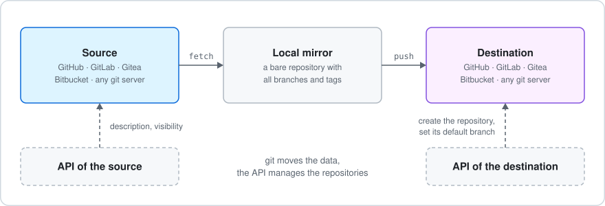

# pygitmirror

[](https://github.com/pygitmirror/pygitmirror/actions/workflows/tests.yml)
[](https://pygitmirror.readthedocs.io/)
[](https://pypi.org/project/pygitmirror/)
[](https://pypi.org/project/pygitmirror/)
[](https://github.com/pygitmirror/pygitmirror/blob/master/LICENSE)

Clone, sync and migrate git repositories between GitHub, GitLab, Gitea, Bitbucket and any other git server. A command, `git-mirror`, a page which runs on your own machine, and a Python library.

```shell
export GIT_MIRROR_SOURCE_TOKEN=...       # a GitHub token
export GIT_MIRROR_DESTINATION_TOKEN=...  # a Gitea token

git-mirror sync --source github \
    --destination gitea --destination-url https://git.example.com \
    --org my-org --all
```



- **Three operations**: `clone` only adds, `sync` makes the destination equal to the source, `migrate` clones, verifies and can archive the source
- **Creates what is missing**: destination repositories are created with the description and visibility of the source
- **All branches and tags**, for one repository or every repository of an organization
- **Cheap to repeat**: a repository which did not change costs two short requests and no download
- **Careful with tokens**: read from the environment, never written to a file, a URL or a command line
- **Runs locally**: your machine, your tokens; nothing is sent anywhere but to the two servers
- **No dependencies**: needs Python 3.11 and git 2.31, nothing else
- **Typed**: type hints throughout, checked with mypy in strict mode

Full documentation: **https://pygitmirror.readthedocs.io/**

## Installation

```shell
pip install pygitmirror
```

## Operations

| | `clone` | `sync` | `migrate` |
| --- | --- | --- | --- |
| adds missing branches and tags | yes | yes | yes |
| moves a branch forward | yes | yes | yes |
| overwrites a branch or tag which differs | no, fails | yes | no, fails |
| deletes what the source does not have | no | yes | no, fails |
| checks the destination afterwards | no | no | yes |
| can archive the source | no | no | yes |

Add `--dry-run` to any of them to see what would be done.

```shell
# A first copy which cannot overwrite anything
git-mirror clone --source github --destination gitlab --org my-org --repo api web

# Keep a copy up to date, for example from cron
git-mirror sync --source github --destination gitlab --org my-org --all

# Move to a new home and make the old one read-only
git-mirror migrate --source bitbucket --destination github \
    --org my-workspace --destination-org my-org --all
```

Only branches and tags are copied: not issues, pull requests, wikis, releases or Git LFS files.

## The page

```shell
git-mirror serve
```

prints a link to a page on your own machine: choose two servers, list the repositories, preview, and run. Or with Docker:

```shell
docker run -d --name git-mirror \
    -p 127.0.0.1:47417:47417 \
    -v git-mirror-data:/data \
    --add-host host.docker.internal:host-gateway \
    ghcr.io/pygitmirror/pygitmirror

docker logs git-mirror    # shows the link to open
```

- A repository passes through a copy on your machine, so the volume needs room for the largest repository, or for all of them if the copies are kept to make the next sync fast.
- Inside the container, a server on your machine is `host.docker.internal`, not `localhost`.
- The page offers Gitea, Forgejo, GitLab and plain git servers for now; the command has all hosts.

See [the guide to the page](https://pygitmirror.readthedocs.io/en/latest/guide/web.html).

## Hosts

| Provider | Servers | Creates repositories |
| --- | --- | --- |
| `github` | github.com, GitHub Enterprise Server | yes |
| `gitlab` | gitlab.com, self-managed GitLab | yes |
| `gitea` | Gitea, Forgejo | yes |
| `bitbucket` | bitbucket.org | yes |
| `plain` | any git server or local folder | no, the destination must exist |

Without `--source` or `--destination` a host is plain, and the URL of a repository is the address followed by the owner and the name:

```shell
git-mirror clone --source-url ssh://git@old.example.com:7999 \
    --destination-url https://git.example.com --org my-project --repo api
```

## Settings file

To name many repositories at once, use a JSON file, in which lines starting with `//` are comments:

```
{
  "sync_path": "/var/lib/git-mirror",
  "source": { "provider": "github" },
  "destination": { "provider": "gitea", "url": "https://git.example.com" },
  "repos": {
    // These two only.
    "organization-1": ["repo-1", "repo-2"],
    // Every repository of the organization.
    "organization-2": "*"
  }
}
```

```shell
git-mirror sync --config settings.json
```

## Python

```python
from pygitmirror import Mirror, make_host

source = make_host("github", token=github_token)
destination = make_host("gitea", url="https://git.example.com", token=gitea_token)

mirror = Mirror(source, destination, workdir="/var/lib/git-mirror")
result = mirror.sync("my-org/api")
print(result.summary())
```

## Upgrading from 0.0

Calls such as `git-mirror --source_url ... --destination_url ... --org ... --repo ...` and the settings files of the first versions still work; they run `clone`. The [changelog](https://pygitmirror.readthedocs.io/en/latest/project/changelog.html) lists what changed.

## Development

```shell
git clone https://github.com/pygitmirror/pygitmirror.git
cd pygitmirror
make install  # create the environment with uv
make check    # lint, type check, test and build the docs
```

See [CONTRIBUTING.md](CONTRIBUTING.md).

## License

MIT. Maintained by [Bassem Girgis](https://girgis.me).
